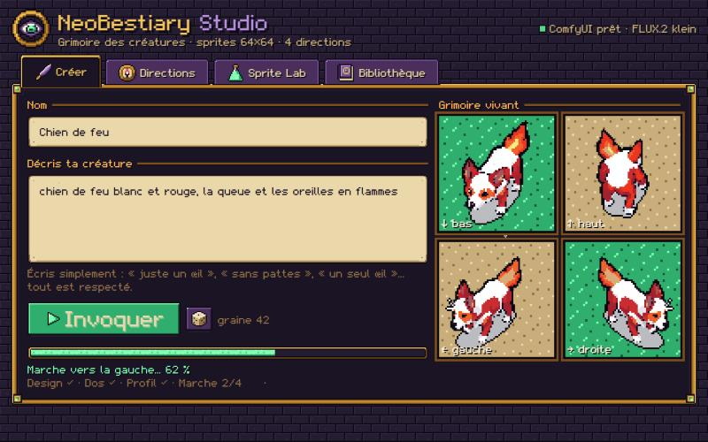

# NeoBestiary Studio

Décris une créature en français, NeoBestiary Studio la dessine en **sprite pixel art 64×64**, vue de dessus, dans les **4 directions** avec une **marche en 3 images**, prête pour un jeu, et lui écrit sa **fiche de bestiaire**.

## Ce qu'il sait faire

- **Inspiration** : en panne d'idée ? Choisis un thème (Lovecraft, Animaux, Monstres, Folklore ou Mélange) et clique « Inspire-moi » : tu reçois un nom et une description claire, écrite pour le dessin (forme, posture, nombre d'yeux ou de pattes, couleurs). Tu la retouches si tu veux.
- **Créer** : tu écris ce que tu veux (« juste un œil géant », « une vache avec une seule corne », « un taureau au corps d'araignée »…), sans rien imposer ni interdire. L'appli dessine d'abord **3 esquisses** en une demi-minute : tu choisis la plus fidèle, et le dos, le profil et la marche sont faits à partir d'elle. Avant de dessiner, l'appli lit ta description et en retient la posture (à quatre pattes, debout, qui flotte, qui rampe, qui nage) et le nombre de pattes : elle te dit ce qu'elle a compris, et le dos et le profil la respectent (une créature qui flotte reste dans les airs, sans pattes inventées). Elle détaille aussi chaque partie avec son nombre et sa place (« trois têtes, chacune sur son cou ») et connaît les traits des monstres et objets classiques : hydre, cerbère, mimique, tyrannœil, chimère, kitsune, golem, liche, armure hantée… Tes nombres et tes couleurs restent prioritaires.
- **Sprites 64×64** : la réduction garde les petits détails contrastés, les yeux et leurs pupilles ne disparaissent plus dans la peau.
- **Marche** : les pattes de la pose de repos s'animent (un côté puis l'autre de face et de dos, pattes avant et arrière en balancier de profil). La créature reste identique d'une image à l'autre, mêmes pixels, mêmes couleurs. Une créature sans pattes (œil, pieuvre, serpent) ondule sur place ; une créature qui flotte monte et descend doucement.
- **Fiche de bestiaire** : à la fin de la création, une fiche façon Pokédex est écrite toute seule : type, espèce, taille, poids, habitat, description et une petite histoire. Elle s'affiche avec le portrait, dans une police de livre facile à lire. « Réécrire la fiche » en propose une autre.
- **Directions** : la planche 4 directions × 3 pas. Chaque image a ses versions (◀ ▶) et chaque direction peut être refaite ; refaire la face refait toute la créature.
- **Sprite Lab** :
  - un éditeur pixel 64×64 (crayon, gomme, pipette, seau, annuler / refaire) ;
  - la palette commune aux 12 images, le contour ;
  - un aperçu en jeu : ta créature marche sur l'herbe avec les flèches du clavier.
- **Export** : chaque créature exportée va dans le dossier `Exports` (bouton dans la Bibliothèque), un sous-dossier par créature : la planche PNG (3 colonnes × 4 lignes de 64×64), son JSON (directions, images, point d'ancrage aux pieds, ordre de l'animation, fiche) et le portrait en grand.
- **Bibliothèque** : toutes tes créatures, avec recherche. Une créature supprimée part dans une corbeille, elle n'est pas effacée.

Les créatures sont rangées dans `Documents\NeoBestiary Studio`, les exports dans `Documents\NeoBestiary Studio\Exports`.

## Ce qu'il faut

- Windows et une carte graphique **NVIDIA avec 8 Go de mémoire vidéo** ou plus.
- **ComfyUI portable** ([github.com/comfyanonymous/ComfyUI](https://github.com/comfyanonymous/ComfyUI), page Releases), décompressé n'importe où. Au premier lancement, l'appli le cherche et, si besoin, te demande son dossier.
- Les modèles de dessin, que l'appli propose d'installer elle-même (licences libres, depuis Hugging Face, environ 15 Go en tout) :
  - **FLUX.2 klein 4B** (le dessin) ;
  - l'encodeur **Qwen3 4B** (il comprend le français) ;
  - **BiRefNet** (détourage : ni fond ni ombre au sol).
- Pour l'inspiration et les fiches : **Ollama** ([ollama.com](https://ollama.com)) avec un modèle de texte, par exemple `ollama pull mistral-nemo` (environ 7 Go, très bon en français). Sans lui, tout le reste fonctionne ; seules l'inspiration et les fiches attendent, et la posture est devinée par mots-clés.

ComfyUI démarre tout seul à la première invocation et s'arrête quand tu fermes NeoBase. Si tu as déjà lancé ton propre ComfyUI, l'appli l'utilise et ne l'arrête pas.

## Combien de temps

Sur une RTX 4060 : une demi-minute pour les 3 esquisses, puis environ 2 minutes pour le dos, le profil (deux essais chacun, le meilleur est gardé automatiquement), la marche et la fiche. Une idée d'inspiration prend une dizaine de secondes (une minute la première fois, le temps de charger le modèle de texte).

## Permissions

L'appli demande l'**accès complet** : elle lance le moteur de dessin (Python, livré dans le plugin), ComfyUI et parle à Ollama sur ton PC, et enregistre tes créatures dans tes Documents. Rien ne part sur Internet, sauf le téléchargement des modèles si tu le demandes.
